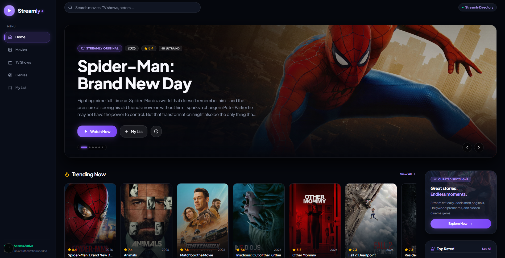
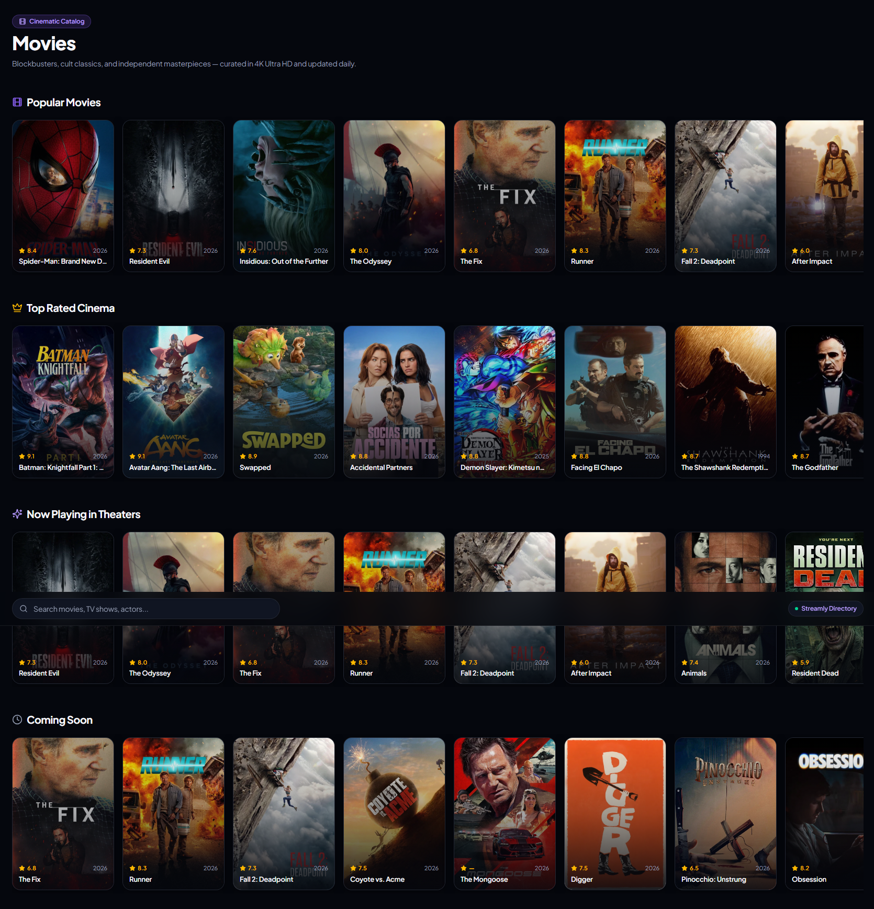
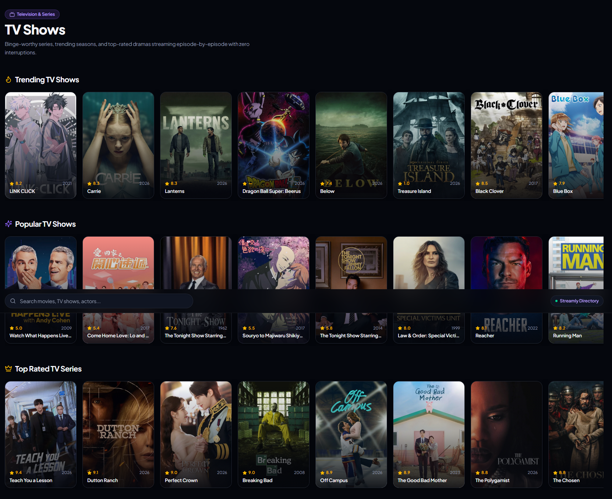
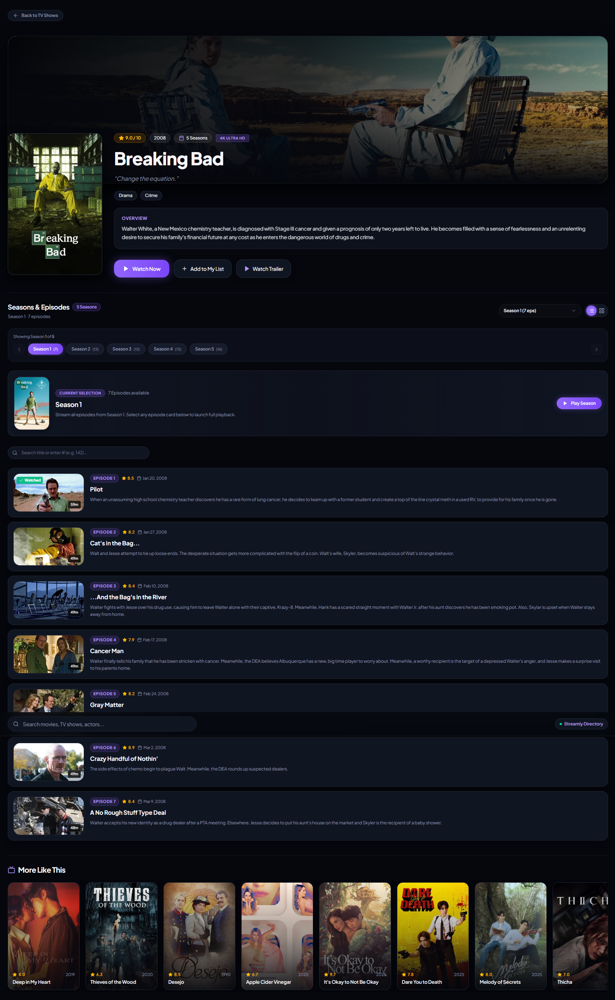
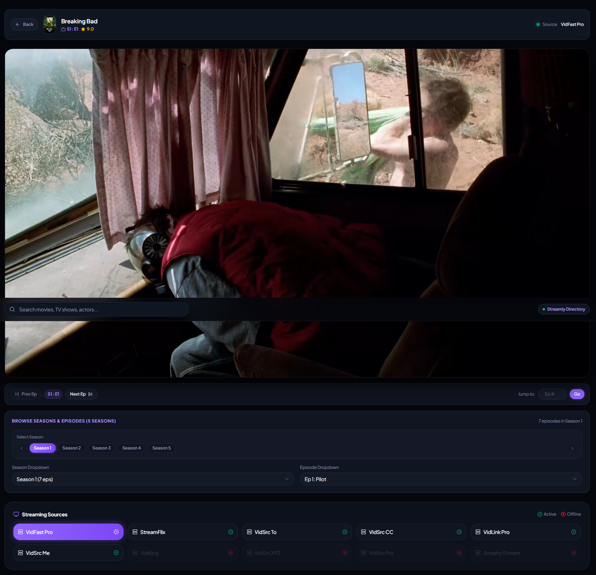

# Streamly

Welcome to **Streamly**, an ad-free streaming platform for movies and TV series! Streamly offers a seamless and enjoyable viewing experience, allowing you to watch your favorite content without interruptions.

## Features

- **Ad-Free Streaming** — Enjoy a clean, uninterrupted viewing experience with no advertisements.
- **Extensive Content Library** — Browse a wide range of movies and TV series, powered by the TMDB API.
- **Powerful Search** — Search by title across movies and TV series, with live suggestions as you type.
- **Multiple Streaming Servers** — Choose from **10 different servers** (VidFast Pro, VidKing, StreamFlix, VidSrc To / XYZ / CC / Me / Pro, VidLink Pro, and Smashy Stream) with automatic availability checks, so there's always a working source.
- **Season & Episode Browser** — Full season picker with paginated episode lists, air dates, runtimes, and stills.
- **Continue Watching** — A progress-bar rail with remaining-time estimates on the home page.
- **My List** — Save titles to a personal watchlist that persists in your browser via local storage.
- **Episode Tracking** — Mark episodes as watched and search within a season's episode list.
- **Trending & Curated Rows** — Trending, popular, top rated, now playing, and upcoming rails across home, movies, and TV pages.
- **Trailers** — Watch trailers in a modal without leaving the page.
- **Cinematic Dark UI** — A custom design system with a `#635bff` brand accent, glass cards, ambient gradients, and a fully responsive full-bleed layout.
- **Privacy & Cookie Policy Pages** — Built-in legal pages with a consent banner.

## Screenshots

Here are some images and screenshots showcasing Streamly's features:


*Homepage*


*Movies*


*Tv Shows*


*Details*


*Watch content with the option to select from multiple streaming servers.*

## Tech Stack

- **Framework:** [Next.js 15](https://nextjs.org/) (App Router) + React 18
- **Language:** TypeScript
- **Styling:** [Tailwind CSS v4](https://tailwindcss.com/), Radix UI primitives, `tailwind-merge`, `class-variance-authority`
- **Data:** [TMDB API](https://www.themoviedb.org/documentation/api) via a typed client in `lib/tmdb.ts`

## Getting Started

### 1. Install dependencies

```bash
npm install
```

### 2. Configure environment variables

Copy the example file and fill in your keys:

```bash
cp .env.example .env.local
```

| Variable | Required | Description |
| --- | --- | --- |
| `NEXT_PUBLIC_TMDB_API_KEY` | **Yes** | Your TMDB API v3 key. Drives all catalog data. |
| `NEXT_PUBLIC_TMDB_BASE_URL` | Yes | TMDB API base URL — `https://api.themoviedb.org/3` |
| `NEXT_PUBLIC_TMDB_IMAGE_URL` | Yes | TMDB image base URL — `https://image.tmdb.org/t/p/original` |
| `GITHUB_TOKEN` | No | Read by `scripts/fetch-github-stats.mjs` during `npm run build`, which writes `public/github-stats.json` (the footer's star/fork counts). It is used on your own machine only and is never shipped to the browser. Omit it and the star pill just hides itself. |

### 3. Run the dev server

```bash
npm run dev
```

The app starts on [http://localhost:3000](http://localhost:3000) (falling back to the next free port if 3000 is taken).

### Production build

```bash
npm run build
```

That one command runs three steps:

| Phase | Script | What it does |
| --- | --- | --- |
| `prebuild` | `scripts/fetch-github-stats.mjs` | Calls GitHub with `GITHUB_TOKEN` and writes `public/github-stats.json` (the footer's star/fork counts) |
| `build` | `next build` | Static export (`output: "export"`) into `out/` |
| `postbuild` | `scripts/copy-build.mjs` | Copies `out/` into **`build/`**, the deployable artifact |

> **Dev and build can run side by side.** They used to fight over `.next/` and corrupt each other. Dev now writes to `.next-dev` while the production build keeps the conventional `.next` (see `distDir` in `next.config.mjs`), so a running dev server — including one your IDE keeps alive — no longer breaks builds.

Preview what will actually ship with:

```bash
npm start
```

### Deploying to shared hosting (cPanel / Hostinger / Apache)

1. Run `npm run build`.
2. Upload the **contents** of `build/` (not the folder itself) into your web root — typically `public_html/`.
3. Confirm `build/.htaccess` came along. Most FTP clients hide dotfiles, so enable "show hidden files".

The `.htaccess` is required, not optional. Next.js exports `/movies` as a flat `movies.html`, which Apache will not serve at an extensionless URL without a rewrite. It also 301-redirects the old `/movie/550` links onto `/movie?id=550`.

Because Next.js emits absolute `/_next/...` asset URLs, deploy to the **domain root**, not a subdirectory.

#### What changed for static hosting

Two features previously needed a server at runtime:

| Removed route | Static replacement |
| --- | --- |
| `/api/proxy` | Availability is probed from the browser with an opaque `no-cors` request. All 10 servers appear immediately and unreachable ones are demoted afterwards — if nothing answers at all (adblocker, offline, strict CORS) every server stays enabled rather than hiding the lot. |
| `/api/github-stats` | Counted at build time. A `prebuild` step calls GitHub with `GITHUB_TOKEN` and writes `public/github-stats.json`, which the footer serves as a plain static file — so there is no rate limit and the token never reaches the browser. Counts refresh on every `npm run build`. |

Detail pages also moved from path segments to query parameters — `/movie/550` is now `/movie?id=550` — because a static host cannot render a movie it did not prerender at build time.

## Project Structure

```
app/
  page.tsx                  Home — hero, rails, editorial right rail
  movies/  tv-shows/        Catalog listings
  trending/  genres/        Discovery pages
  search/                   Search with live suggestions
  my-list/                  Local-storage watchlist
  movie/                    Movie details (?id=…)
  tv/                       TV details + season/episode browser (?id=…)
  watch/                    Player with server selection (?id=…)
  privacy-policy/           Legal pages
  cookies-policy/
components/                 UI components (see below)
hooks/                      use-watchlist, use-mobile, use-toast
lib/
  tmdb.ts                   Typed TMDB client + image helpers
  constants.ts              Nav links, developer info
  utils.ts                  `cn()` class helper
scripts/
  fetch-github-stats.mjs    prebuild — GitHub star/fork counts -> public/github-stats.json
  copy-build.mjs            postbuild — copies the static export into build/
public/
  .htaccess                 Apache rewrites — required for the static export
  github-stats.json         Written at build time (gitignored)
  *.svg                     Favicon and placeholder assets
screenshots/                README screenshots
```

### Key components

| Component | Purpose |
| --- | --- |
| `site-layout.tsx` | Sticky top navbar, search, mobile menu, full-bleed shell |
| `hero-section.tsx` | Landing hero |
| `movie-row.tsx` / `movie-card.tsx` | Horizontal rails and poster cards |
| `season-episodes.tsx` | Season chips + paginated episode list |
| `continue-watching.tsx` / `right-rail.tsx` | Home page modules |
| `icons.tsx` | **Single source of truth for all icons** — brand marks, custom SVGs, and lucide re-exports |
| `footer.tsx` | Compact footer with GitHub stats, TMDB attribution, and disclaimer |
| `safe-image.tsx` | Image wrapper with graceful fallbacks |

## Routes

| Route | Description |
| --- | --- |
| `/` | Home — hero, continue watching, trending/popular/top rated rails |
| `/movies` | Movie catalog — popular, top rated, now playing, upcoming |
| `/tv-shows` | TV catalog |
| `/trending` | Trending movies and TV |
| `/genres` | Browse and filter movies by genre |
| `/search` | Search across movies and TV |
| `/my-list` | Your saved watchlist |
| `/movie?id=…` | Movie details, trailer, and similar titles |
| `/tv?id=…` | TV details with season and episode browser |
| `/watch?id=…` | Player — pick one of 10 streaming servers |

## How It Works

1. **Search for Content** — Use the search bar to find movies and TV series by title, with live suggestions as you type.
2. **Select a Server** — Choose from a list of available servers to start watching your selected content. Streamly probes each source in the background and marks the ones that don't answer as offline.
3. **Enjoy Ad-Free Viewing** — Stream your favorite movies and TV shows without any interruptions.

## Disclaimer

Streamly does not host, upload, or store any media files on its servers. All video streams are retrieved and embedded from third-party services. We are not responsible for the compliance, copyright, or legality of third-party hosted content.

This product uses the TMDB API but is not endorsed or certified by TMDB.

## License

This project is licensed under the [MIT License](./LICENSE) — © 2024 Gambhir Poudel.

## Contact

For any inquiries or support, please contact us at:

- **Email**: gambhir.poudel@gmail.com
- **GitHub**: [ZaddyAI/streamly](https://github.com/ZaddyAI/streamly)

---
